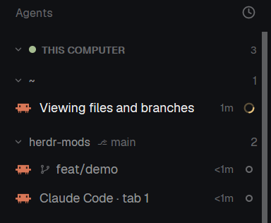

# Agents by repo

The agents list, grouped so you always know what each agent is working on: by machine, then by
the main repository, one compact line per agent named after the branch it is on.

## What you see

- **Machine headers:** `THIS COMPUTER` (green dot) and one per ssh machine (blue dot), with the
  agent count. Clicking a header folds that machine. When folded, it still shows the most urgent
  status.
- **Project headers** under each machine: the main repo's name (the main checkout, not the worktree),
  its branch and the agent count. Spaces that aren't in a git repo get their own header.
- **Agent rows**, one line, 30 px: the agent icon, then its branch with a ⎇ icon when the agent's
  pane is on a branch other than `main`/`master`, else its tab or title. On the right, how long it
  has been in its state and a status dot (working, done, blocked, idle). Hovering shows a tooltip
  with title · space · branch · folder.
- A sort menu (clock icon): "Most urgent first" (blocked and done on top) or "Space order".

## How it behaves

- Each agent's space folder is asked once (refreshed every 20 s) for
  `git rev-parse --show-toplevel` and `--git-common-dir`. Spaces whose common dir is the same repo
  are grouped under the space that holds the main checkout, so agents in worktrees appear under their
  main project.
- Groups are ordered by machine first (this computer, then machines in order), then by urgency or
  space order.
- Alt+Up / Alt+Down move between agents in the visible order (`setAgentOrder` follows the list).
- Clicking a row focuses that agent's pane. Pinned agents and sub-agents keep the shipped behavior.

## Built from

- A clone of herdr's shipped `agents` mod (`mod.json` keeps `cloned_from`). The changes are in
  `render` (machine and project grouping, the one-line rows) plus `repoOf`, `groupSpace`, `familyOf`.
- `mod.json`: `"place": "none"`. Put it in your layout in place of the `agents` block
  (`"mod": "agents"` → `"mod": "my-agents"`).

## Watch out

- Runs `git` in each space's folder, on that space's machine.
- A machine that's away keeps its last known grouping until it answers again.
- Icons come from the shipped `workspace-chrome` mod (`chevron-*.svg`, `branch.svg`).

## Done when

- With agents on two machines, each machine has its own header.
- An agent in a worktree of repo X shows under X's header, named after the worktree's branch.
- An agent on `main` shows its tab name instead.
- Folding a machine hides its projects and agents.
