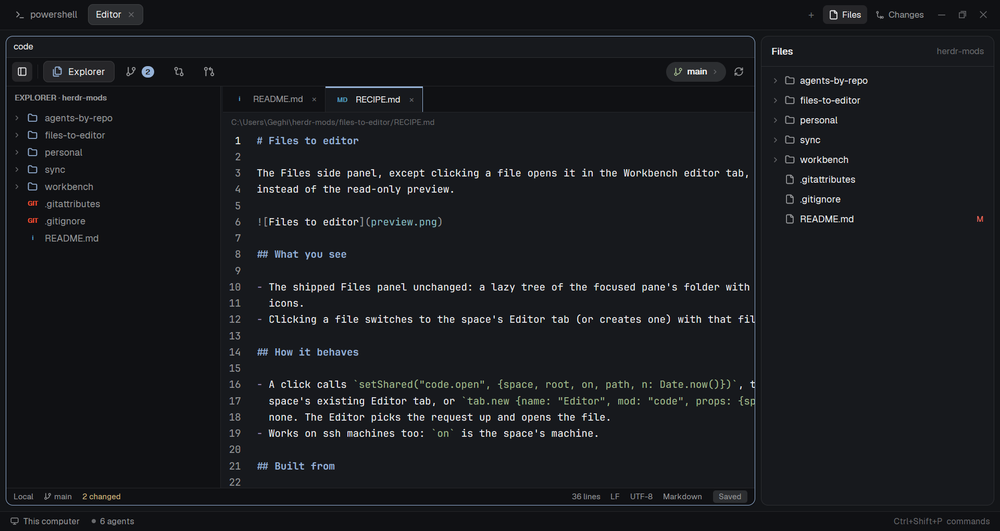

# Files to editor

The Files side panel, except clicking a file opens it in the Workbench editor tab, ready to edit,
instead of the read-only preview.

## What you see

- The shipped Files panel unchanged: a lazy tree of the focused pane's folder with folder and file
  icons.
- Clicking a file switches to the space's Editor tab (or creates one) with that file open.

## How it behaves

- A click calls `setShared("code.open", {space, root, on, path, n: Date.now()})`, then `tab.select` on the
  space's existing Editor tab, or `tab.new {name: "Editor", mod: "code", props: {space}}` when there is
  none. The Editor picks the request up and opens the file.
- Works on ssh machines too: `on` is the space's machine.

## Built from

- A clone of herdr's shipped `files` mod (`mod.json` keeps `cloned_from`), plus the
  `openInEditor` helper at the top of `main.js` and the row's `on_click`.
- `mod.json`: `"place": "none"`. Put it in your layout in place of the `files` block
  (`"mod": "files"` → `"mod": "my-files"`).

## Watch out

- Needs the **Workbench** mod (`mods/code`) installed; without it the click opens an empty tab.

## Done when

- Clicking a file in the Files panel shows it in the Editor tab, editable, on this computer and on an
  ssh machine.
