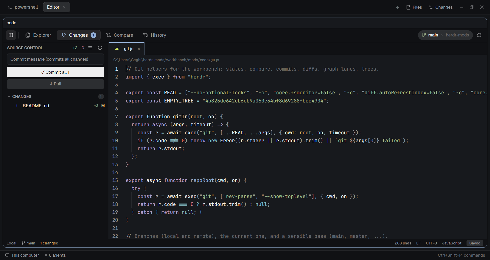

# Workbench

A VS Code-style editor that opens as a tab: browse and edit files, review working changes, compare
your branch with main, and read the git history with diffs, all inside one Editor tab that follows
the space you are in, on this computer or on an ssh machine.

## What you see

- **Top bar:** four view icons on the left: Explorer, Changes, Compare, History. In the middle, the
  repo name and a branch pill (`⎇ branch ▸`) that opens the branch switcher. On the right, a toggle
  for the sidebar.
- **Sidebar** (default 300 px, drag its right edge to resize, drag below 120 px to hide it, double-click
  the edge to reset):
  - **Explorer:** a lazy file tree of the space's folder. Each file has a small colored badge for its
    type (TS, JS, PY, MD, JSON…). The header has New file, New folder and Refresh buttons. New
    file/folder puts a name field (accent border) at the top of the selected folder, or of the
    selected file's folder, or of the root. Enter creates it (`a/b.txt` also makes the folders),
    Escape or clicking away cancels, and a taken name shows "Already exists" in red under the field.
    A new file opens in the editor. The active file is revealed: its folders open, its row is
    selected and scrolled into view (also from the "Reveal in Explorer" button above the editor).
  - **Search** (Ctrl+Shift+F in the Editor, or "Search in files" in the palette): a search field
    with three toggles inside (Aa match case, ab whole word, .* regular expression), and under a
    chevron "files to include" and "files to exclude" (comma-separated: `*.ts, src/api`,
    `node_modules, dist`; a bare name matches at any depth, folder or file) with a .gi toggle
    for skipping .gitignored files. Results come 350 ms after typing: "N results in M files",
    then a folder tree (single-child chains as `a/b/c`) or a flat list, each file with its match
    count and each match as a row with ~16 characters before it, the match highlighted and the line
    number. Clicking a match opens the file with the match selected. Header buttons: search again,
    tree/list, collapse/expand all, clear. A selected word in the open file pre-fills the field.
  - **Changes:** a commit message box and VS Code's one big button: ✓ Commit (staged files only if
    any are staged, else everything) with a ▾ menu (Commit, Commit & Push, Commit & Sync); with no
    changes it becomes ☁ Publish Branch (no upstream) or ⟳ Sync Changes ↓n ↑m (behind/ahead).
    Under it a branch line: branch, ↓behind ↑ahead · upstream, and small Fetch / ↓ Pull / ↑ Push /
    ⟳ Sync buttons. Below them, STAGED CHANGES and CHANGES
    sections, shown as a folder tree or a flat list. Each row shows a status letter (M/A/D/R/U)
    and +/− counts. Hovering a row shows open / discard / stage-or-unstage buttons. A ⋯ menu adds
    "Add to .gitignore", "Add folder to .gitignore", "Ignore all *.ext files", "Copy path" and
    "Copy full path". Discarding asks for confirmation in a red banner.
  - **Compare:** two branch pickers, base (defaults to main/master) and target (defaults to the
    current branch), with a swap button and an "Include uncommitted changes" checkbox. Below them, the tree of
    files changed since the merge base, with ahead/behind counts.
  - **History:** branch scope (current branch or all), then the commit list.
- **Main area:** document tabs (files, diffs, the History graph) with an unsaved dot. Files open in a
  code editor with syntax colors picked from the file name. Diffs show the file's path in their header: clicking it, or the "Open file" button next to it
  (left of the switches, so it's never cut off), opens the file as it is now in an editor tab
  (not for deleted files). In Changes and Compare, Ctrl+click on a row does the same, a plain click
  opens the diff, and hovering a row shows an Open file icon. Diffs also have two switches in their header:
  Changes / Full file (only the changed parts with 4 lines of context, or the whole file with the
  changes marked, scrolled to the first change) and Unified / Split. Both are remembered. Red and
  green line backgrounds, line numbers on both sides. History shows one row per commit:
  graph lanes, ref badges, subject, author and relative time. Clicking a commit lists its changed
  files as a tree, and each one opens as a diff.
- **Status bar:** `Local` or `SSH: <machine>`, branch and "N changed"/"clean", the last message,
  then for an open file its line count, CRLF/LF, UTF-8, language and a Save/Saved button.
- Under 1050 px the top bar and sidebar shrink to a compact form.

## How it behaves

- Opens with **Ctrl+Shift+Y** (or "Open editor" in the command palette). Pressing it again switches
  to the space's existing Editor tab instead of making another one.
- The root is the space's folder (the first terminal's working directory). On a space on an ssh
  machine, files are read with `readTextFile(path, {on})`, git runs through `exec(..., {on})`, and saves go
  through `exec` as chunked base64 (`sh`, or PowerShell when the remote has no `sh`), size-checked
  before the file is replaced.
- **Ctrl+P** (Go to file): a 600 px box at the top center with a field and up to 60 files. With no
  text, open files come first. Typing fuzzy-matches the repo's files (`git ls-files` tracked +
  untracked; outside a repo only file names, at most 20,000 and 8 levels deep, skipping
  node_modules, AppData, .cache and similar: `find | head` or a .NET walk on Windows), preferring the file name, runs and word
  starts; matched letters are accent and bold, the folder is dim. ↑/↓ move, Enter or a click opens,
  Esc or a click outside closes, `name:42` opens at line 42.
- **Ctrl+ù** (and Ctrl+/) toggles a line comment on the line or the selected lines: `//`, `#`, `--`,
  `<!-- -->` or `/* */` by file type, at the lines' common indent; all commented lines are
  uncommented instead.
- Keys while the Editor has focus: Ctrl+S save, Ctrl+W or Ctrl+F4 close the open file (not the
  tab), Ctrl+B toggle the sidebar. Showing the tab focuses the active document automatically, so
  Ctrl+F4 works right after opening.
- Local saves check the file on disk first and show a conflict banner if it changed.
- Branch switcher: filter field, LOCAL and REMOTE lists, "create from current" field. A remote
  branch opens as a local tracking branch. A branch checked out in another worktree, or
  uncommitted changes that would be overwritten, get a plain explanation instead of git's error.
- Open files that were not edited reload after a branch switch or a pull.
- Sidebar width, view, tree/list mode and open files are kept per space.
- `tab.new` props: `open` (a path or a list of paths, relative to the space folder) opens files, and
  `view` (`explorer`, `changes`, `compare`, `graph`) picks the starting view.
- Search runs `git grep -n --column -I --untracked` in the space folder, on the space's machine;
  regex mode is `-P`, falling back to `-E`. Outside a git repo it doesn't run and says why:
  `git grep --no-index` walks the whole tree whatever `--max-depth` says (a home folder took
  minutes and hundreds of MB), and `exec`'s timeout stops waiting but doesn't kill the process. Up to 200 matches per
  file and 5000 in all, 2500 rows drawn. The `find` prop (`tab.new` props) opens Search with that text.
- New files and folders are made with `sh` (`mkdir -p`, `set -C`), or PowerShell on Windows and on ssh machines without `sh`; an existing name is never overwritten.
- Other mods can open a file in it: `setShared("code.open", {space, root, on, path, n: Date.now()})`, then select or
  create the Editor tab (see the files-to-editor mod).

## Built from

- `mods/code/main.js` (the `View`), `git.js` (git commands, diff rows, graph lanes, file trees),
  `icons.js` (file-type badges), `langs.js` (file name to syntax), plus lucide-style SVG icons.
- `mod.json`: `"place": "none"`, `"focusable": true`, palette entries "Open editor" (`tab.new` with
  `mod: "code"`), "Git: Pull" / "Git: Push" / "Git: Sync (pull, then push)" / "Git: Fetch" (`code.pull`, `code.push`, `code.sync`, `code.fetch`), "Search in files" (`code.search`), "Go to file…"
  (`code.quickopen`) and "Toggle line comment" (`code.comment`).
- `keys.json`: the global Ctrl+Shift+Y and the `mod:code` section (Ctrl+Shift+F `code.search`, Ctrl+P `code.quickopen`, Ctrl+ù and Ctrl+/ `code.comment`).
- gpui-base: `Editor`/`EditorState`, `Input`/`InputState`, `v_virtual_list` for long lists and the
  graph.

## Watch out

- The mod runs programs: `git` everywhere, `sh` or `powershell` for folder listing and remote saves.
- Syntax colors come from herdr's built-in grammars (Sublime defaults). TypeScript, TOML, .env and
  Dockerfile have no grammar there, so they use the closest one (JS, YAML, shell).
- Rows in a `v_virtual_list` can't use `on_click`; use the list's `on_item_click`.
- A copy can't ask which tab it's in, and `init` (app start, every hot reload) runs while some other
  space may be active. So on every render, if the focused tab holds a `code` pane and belongs to
  another space, the copy moves to that space (keeps unsaved files, restores that space's session).
- Write `mod.json` before `main.js` when installing, or herdr docks the mod into the layout.
- Pull is `fetch` then `git pull --no-edit`, with `--no-rebase` unless the person set `pull.rebase`
  (VS Code's behaviour; never stuck on git's "divergent branches" question). Sync = fetch, pull if
  behind, push if ahead. Push without an upstream publishes (`push -u <origin or first remote> HEAD`).
  Ahead/behind come from `rev-list --left-right --count @{u}...HEAD`, refreshed with the changes list;
  there's no auto-fetch, so incoming commits show after Fetch/Sync. Errors map to short reasons
  (conflicts, rejected push, overlapping local changes, no upstream, auth).

## Done when

- Ctrl+Shift+Y opens the Editor at the space's folder; a second press returns to the same tab.
- Editing a file and pressing Ctrl+S saves it, also on an ssh machine.
- Changes lists staged and unstaged files; stage, unstage, discard and .gitignore work.
- Compare shows the files changed against main; History shows commits and their diffs.
- Ctrl+F4 closes the open file, not the Editor tab.
